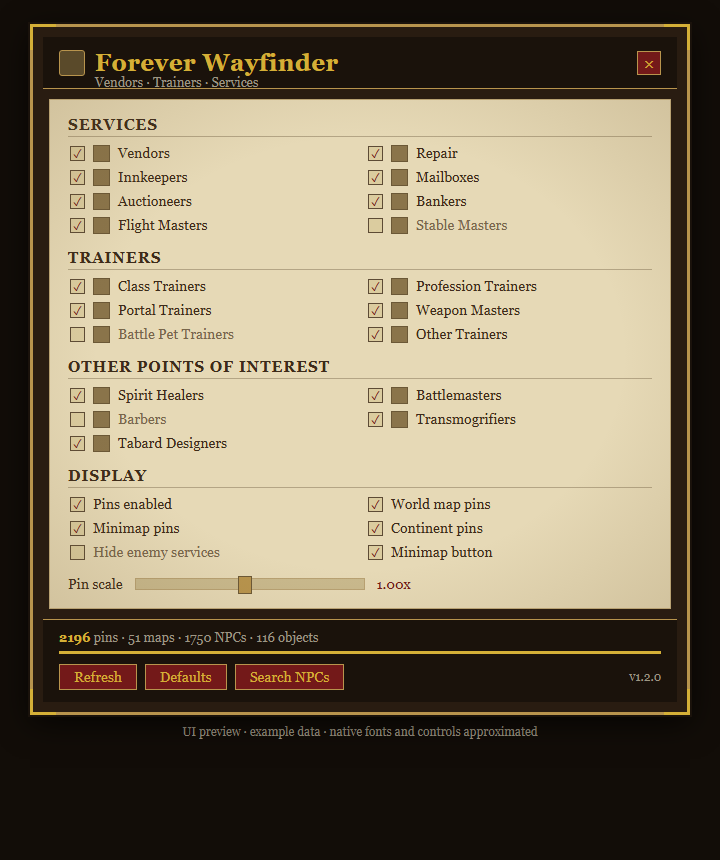

# Forever Wayfinder

Find vendors, trainers and service NPCs on the world map and the minimap in World of Warcraft: Forever.

Forever Wayfinder reads its location data from **QuestieDB** at runtime and displays it through **HandyNotes**. No NPC data is bundled with the addon; the pins are built once per login from the QuestieDB you already have installed.

## Features

- Vendors drawn with an icon for what they actually sell: food and drink, trade and profession supplies, reagents, poisons, ammunition, weapons, armor, bags, tabards and mounts.
- Inkeepers, repair vendors, auctioneers, bankers, flight masters, stable masters, mailboxes, class and profession trainers, weapon masters, portal trainers, spirit healers, battlemasters, barbers, transmogrifiers and tabard designers.
- World map and minimap pins, each switchable.
- Optional continent-level pins that roll every zone up onto the continent map.
- Optional faction filter that hides services belonging to the opposite faction.
- Pin scale slider.
- HandyNotes plugin toggle, so the pins can also be switched from the HandyNotes options.
- Optional TomTom waypoints: right-click any pin.
- Draggable round minimap button.
- Search every indexed NPC by name or sub-name, with category and zone/map filters.

## Requirements

- World of Warcraft: Forever (Interface 16001)
- [QuestieDB](https://www.curseforge.com/wow/addons/questiedb) (required)
- [HandyNotes](https://www.curseforge.com/wow/addons/handynotes) (required)
- [TomTom](https://www.curseforge.com/wow/addons/tomtom) (optional, for waypoints)

## Installation

1. Close the game.
2. Extract the `ForeverWayfinder` folder into `World of Warcraft\_forever_\Interface\AddOns\`.
3. Start the game and make sure QuestieDB and HandyNotes are enabled.

Pins are indexed after you log in. The first run takes a moment; `/fw status` shows progress.

## Usage

- `/fw` or `/foreverwayfinder` opens the settings panel.
- `/fw on` / `/fw off` enables or disables all pins.
- `/fw refresh` rebuilds the NPC index.
- `/fw reset` restores default settings.
- `/fw search` opens NPC search; filter by name, category, zone name, or map ID.
- `/fw status` prints index statistics.
- Left-click the minimap button to open the panel, right-click it to toggle minimap pins, drag it to move it around the minimap.
- Hover a pin for the NPC names and coordinates. Right-click it to set a TomTom waypoint.
- In search results, left-click to open/select the result's map when supported by the client; right-click to set a TomTom waypoint.

## Notes

- The zone-to-map mapping is decoded from QuestieDB's own support data, so new QuestieDB zone mappings are picked up without an addon update.
- If the panel says the addon is disabled, the reason is printed in chat: a missing dependency, an outdated QuestieDB contract, or unreadable zone data.

## License

MIT. See `LICENSE`.

## Diagnostics and development tests

- `/fw status` reports index totals, invalid records/spawns, unresolved zone mappings, scan timing and record errors.
- Malformed QuestieDB records are skipped without aborting the full index build.
- Zone-map payloads are decoded in a restricted environment and validated before use.
- Pure Lua regression tests are in `tests/run.lua`. From the repository root, run `lua tests/run.lua` with a Lua 5.1-compatible interpreter.
- The standalone tests do not replace in-game testing against the declared client and supported QuestieDB/HandyNotes versions.
